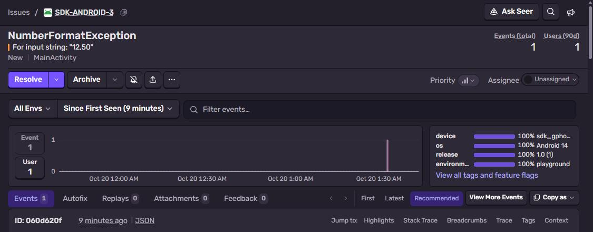
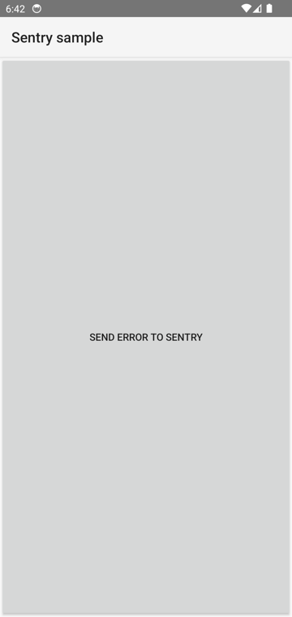
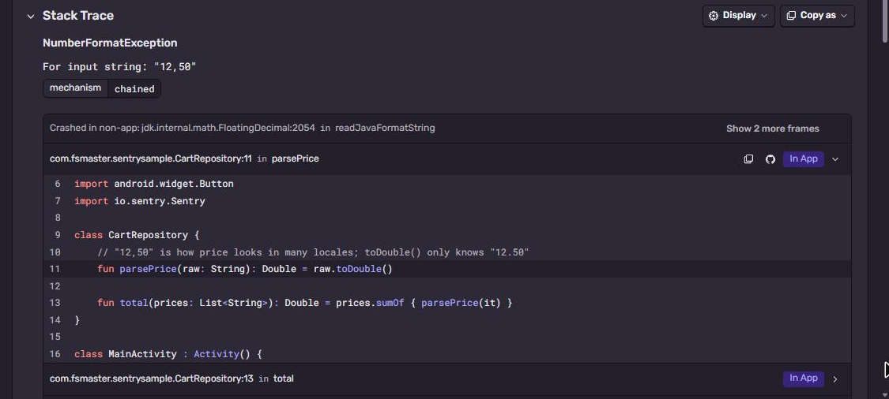

# Sentry + Android (Kotlin)

Kotlin app, release build minified with R8. Class and method names in the APK are obfuscated, the
ProGuard mapping uploaded by the Sentry Gradle plugin turns the stack trace back into real names.
Part of [Sentry Playground](https://github.com/fsmaster/sentry-playground). The playground button runs
the GitHub Actions workflow of this repo: build → emulator → error.



## What you need

- Android Studio (or just JDK 17 + Android SDK), an emulator or a phone
- Sentry project with platform **Android**
- Sentry auth token for the mapping upload: **Settings → Auth Tokens → Create New Token**

## 1. Put your DSN

```bash
git clone https://github.com/fsmaster/sentry-sample-android.git
cd sentry-sample-android
```

Edit `gradle.properties`, set your DSN:

```properties
sentryDsn=https://<key>@<org>.ingest.us.sentry.io/<project-id>
```

In `app/build.gradle.kts` change `org` and `projectName` in the `sentry { }` block to yours.

## 2. Build release (uploads the mapping)

```bash
export SENTRY_AUTH_TOKEN=sntrys_...
./gradlew assembleRelease
```

Windows: `$env:SENTRY_AUTH_TOKEN="sntrys_..."` and `.\gradlew.bat assembleRelease`.

In the build log:

```
> Task :app:uploadSentryProguardMappingsRelease
  UPLOADED 111b8f4f-... (Proguard mapping)
> Task :app:sentryUploadSourceBundleRelease
  UPLOADED 3278c302-... (sources)
```

## 3. Run it

Start emulator (Android Studio → Device Manager), then:

```bash
adb install -r app/build/outputs/apk/release/app-release.apk
adb shell am start -n com.fsmaster.sentrysample/.MainActivity --es run_id test-1
```

Or open the app and press **Send error to Sentry**.



## 4. Check it in Sentry

**Issues** → `NumberFormatException: For input string: "12,50"`. Frames say `CartRepository.parsePrice`
and `MainActivity.sendError`, not `a.a` / `b.c` like in the APK. Kotlin code is shown inline (source
bundle).



## How it works

No init code at all. The SDK starts itself from `AndroidManifest.xml`:

```xml
<meta-data android:name="io.sentry.dsn" android:value="${sentryDsn}" />
<meta-data android:name="io.sentry.traces.sample-rate" android:value="1.0" />
```

Gradle plugin (`app/build.gradle.kts`) does the rest:

```kotlin
plugins {
    id("com.android.application")
    id("io.sentry.android.gradle")
}

sentry {
    org.set("fsmaster")
    projectName.set("sdk-android")
    authToken.set(providers.environmentVariable("SENTRY_AUTH_TOKEN").orElse(""))
    includeProguardMapping.set(true)
    autoUploadProguardMapping.set(true)
    includeSourceContext.set(true)
}
```

- It adds the `sentry-android` dependency itself (auto-installation), you don't write it.
- For every build it generates a UUID, puts it into the APK and uploads the mapping with this UUID.
  Events from the app carry the UUID, this is how Sentry picks the right mapping. Mapping from another
  build doesn't fit, even if code is the same.
- `includeSourceContext` uploads the Kotlin sources, so the code appears next to frames.

Crashes (uncaught exceptions) are saved on disk and sent on **next** start of the app. In the sample we
use `Sentry.captureException` so it sends right away.

## CI

`.github/workflows/trigger.yml`: JDK 17 → `assembleRelease` (mapping upload) → Android emulator
(`reactivecircus/android-emulator-runner`, API 34) → `adb shell am start ... --es run_id <id>`.
It runs on push and on `workflow_dispatch`, the playground calls the last one.

## Troubleshooting

| Symptom | Why |
|---|---|
| Stack trace shows `a.a.b(SourceFile)` | Mapping for this build was not uploaded (no token during build), or you installed APK from different build. |
| No events at all | DSN placeholder empty, check `sentryDsn` in `gradle.properties`. Or emulator without internet. |
| Crash not visible | Crashes are sent on next app start. Open the app again. |
